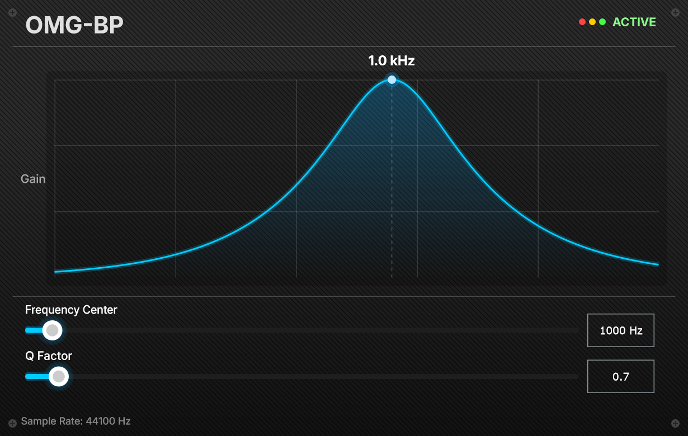

# JUCE‑315 Band‑Pass Filter Plugin 



A real‑time audio VST3 band‑pass filter plugin implemented with the JUCE DSP module for academic assignment.
This plugin uses `juce::dsp::StateVariableTPTFilter` as the core digital filter, providing adjustable center frequency and Q‑factor, with a real‑time frequency‑response visualization UI.

## Features
- Second‑order band‑pass filter based on State‑Variable TPT (Topology‑Preserving Transform) filter
- Adjustable **Center Frequency**: 20 Hz ~ 20000 Hz
- Adjustable **Q‑Factor**: 0.1 ~ 10
- Smoothed parameter transition (25 ms smoothing time) to avoid audio clicks and pops
- Real‑time frequency‑response curve visualization on the graphical editor
- Custom‑styled UI with glowing slider controls
- Support for mono / stereo audio processing
- VST3 plugin format

## Technical Background
- **StateVariableTPTFilter**: Topology‑Preserving Transform state‑variable IIR filter. It applies pre‑warping internally for accurate frequency response near Nyquist frequency. One filter instance supports multiple audio channels, each channel maintains independent filter state variables.
- Parameter smoothing: Frequency uses multiplicative smoothing for logarithmic hearing perception; Q‑factor uses linear smoothing.
- UI drawing: The magnitude curve is calculated using analog‑domain s‑domain transfer‑function formula for visualization. Note there will be minor deviation compared with real digital IIR response at high frequencies close to Nyquist frequency.

## Build Requirements
- CMake >= 3.25
- C++23 compatible compiler (MSVC / Clang / GCC)
- JUCE (fetched automatically via CPM, no manual installation required)
- Supported platforms: Windows, macOS, Linux

## Build Instructions

### 1. Clone repository
```bash
git clone https://github.com/omglion-dev/juce_315_bandpass_plugin.git
```